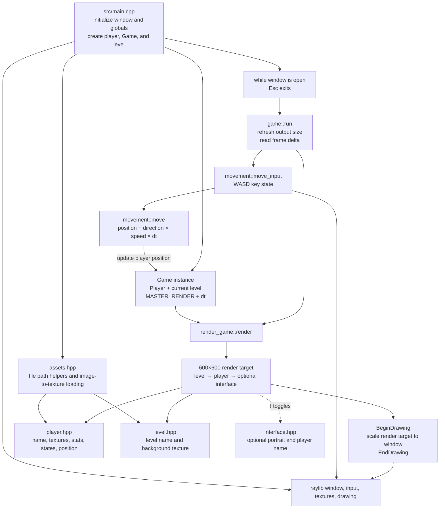

# Game Architecture and Control Flow

> Snapshot of the implemented prototype on `main` as inspected on 2026-11-11. This describes code that is present today, and distinguishes it from planned or incomplete systems.

## Overview

MyLife is currently a small C++17/raylib 2D prototype. `src/main.cpp` owns startup, creates the player and one level, loads their textures, and runs a single-threaded loop. `Game` groups the player, current level, render state, and frame delta; `game::run` updates input-driven movement and delegates drawing to `render_game::render`.

The implementation is modularized into headers under `include/`, but most gameplay and rendering functions are currently defined inline or directly in headers. There is one `.cpp` translation unit in `src/` at present.

## Architecture visualization



## Startup and frame control

1. `main()` in `src/main.cpp` enables a resizable window and calls `InitWindow` at the default external resolution (600×600).
2. `player::create("ian")` initializes the player's name, initializes both state slots to `NORAML`, fills all seven stats with 100, loads portrait and body images, and places the player at the center of the internal 600×600 scene.
3. `render_game::render_setup` allocates a 600×600 `RenderTexture2D` and sets up a vertically flipped source rectangle for presenting it. `lvl::load` loads the `test` level texture.
4. Each iteration checks Escape and calls `game::run(INSTANCE)`.
5. `game::run` reads the current window dimensions into `EXTERNAL_RES`, captures `GetFrameTime()` into `Game::dt`, gets WASD movement input, and writes the new player position using `movement::move` and the constant speed of 150.
6. `render_game::render` updates the destination rectangle on resize; `I` toggles the interface. It renders the level, player, and (when enabled) interface into the fixed internal render target, then clears the window and scales/presents that texture to the current window size.
7. On Escape/window close, `main()` calls `CloseWindow()` and exits.

```mermaid
sequenceDiagram
    participant M as main.cpp
    participant G as game::run
    participant I as movement input
    participant R as render_game
    participant RL as raylib
    M->>RL: InitWindow; create/load player and level
    loop Until window close or Escape
        M->>G: run(Game&)
        G->>RL: GetScreenWidth/Height, GetFrameTime
        G->>I: move_input()
        I->>RL: IsKeyDown(W/A/S/D)
        I-->>G: direction vector
        G->>G: update player position with speed × dt
        G->>R: render(render state, level, player)
        R->>RL: Render level, player, optional UI to 600×600 target
        R->>RL: Draw scaled target to window
    end
    M->>RL: CloseWindow()
```

## Module responsibilities and implementation status

| File | Current role |
| --- | --- |
| `src/main.cpp` | Window setup, global output-resolution definitions, player/level/game construction, asset loading, outer loop, Escape handling. |
| `include/game.hpp` | `Game` data aggregate and per-frame `game::run` orchestration. |
| `include/movement.hpp` | WASD input sampling and delta-time-based position update. |
| `include/player.hpp` | Player model, stat/state constants, texture creation/destruction helpers, basic getters/setters. Stats and states are modeled but do not yet drive simulation in the frame loop. |
| `include/level.hpp` | A level name and background texture, with load/unload helpers. Only one test level is loaded; no level transition logic is wired in. |
| `include/render_game.hpp` | Render-target setup, resize handling, input for the `I` UI toggle, scene composition, and final presentation. |
| `include/interface.hpp` | Optional lower-screen panel, portrait, and player name. `interface::update()` is declared but has no implementation or call site. |
| `include/assets.hpp` | Asset path construction and image loading/resizing to GPU textures. |
| `include/camera.hpp` | Camera data and a target/offset update helper; not currently connected to the game loop or renderer. |
| `include/anim.hpp` | Animation sketch is commented out; no animation runs currently. |
| `include/common.hpp` | raylib/raymath includes, shared vector aliases, internal-resolution constants, external-resolution declarations. |
| `Makefile` | C++17 build using `g++`, raylib, `src/*.cpp`, and generated dependency files. Raylib prefix is hard-coded to `/opt/homebrew/opt/raylib`. |

## Potential performance issues

### Current implementation

- **No obvious heavy per-frame workload at prototype scale.** The active scene is a single background texture, one player texture, an optional portrait/name panel, and one 600×600 off-screen render target. The target is composited once per frame. This is unlikely to be a bottleneck on typical desktop hardware; profile before optimizing.
- **Extra render-target pass and scaling.** Every frame draws the scene to `MASTER_RENDER.master_texture`, then samples that texture to present it. This supports fixed-resolution rendering and scaling, but adds an extra pass and render-target memory/bandwidth versus drawing directly to the window. It is a reasonable current trade-off, but measure it if the internal resolution or scene complexity grows.
- **Unbounded or platform-dependent frame rate.** The loop has no explicit `SetTargetFPS` call. Actual pacing depends on raylib/platform/window behavior; if it runs faster than needed, it can waste CPU and power. Consider an explicit target frame rate or deliberate vsync policy, and use frame-time measurements to verify behavior.
- **Asset load-time cost and memory.** `assets::LoadTexture` decodes an image, resizes it on the CPU, uploads it as a texture, and releases the CPU image. It is called for the player and level during startup now, not every frame. Large source images or future repeated runtime loads could cause slow transitions and temporary memory spikes; cache/reuse assets and load at appropriate sizes if that becomes measurable.
- **Future scene scaling.** Rendering currently has no entity batching, visibility culling, or spatial partitioning. That is immaterial for one player and one background, but drawing many actors, effects, or large tile maps individually could increase CPU draw-call overhead and GPU fill/bandwidth. Add culling/batching only when content and profiling justify it.

### Correctness and lifecycle concerns (not current frame-time bottlenecks)

- **Diagonal movement is faster.** `movement::move_input()` sums axis directions without normalization, so holding a diagonal gives a vector length of √2 and approximately 1.414× the axis speed. Normalize non-zero input if equal movement speed in all directions is intended.
- **Loaded GPU resources are not released on shutdown.** `player::destroy`, `lvl::unload`, and the render target's corresponding unload operation are not called before `CloseWindow()`. This is a resource-lifecycle issue; the operating system typically reclaims resources at process exit, but explicit cleanup is needed for orderly teardown and future reloads.
- **Player position is not constrained by level bounds.** This is gameplay/collision behavior, not a performance issue, but it can move the player off the background as the prototype expands.
- **Fixed internal resolution.** The scene is always rendered at 600×600 and scaled to the window. Higher internal resolutions raise render-target pixel work approximately with pixel count; very different window aspect ratios can also stretch the image. Choose resolution/scaling policy based on intended visuals and profile target devices.

## Build and run

The Makefile currently expects raylib at `/opt/homebrew/opt/raylib` by default; adjust `RAYLIB_PREFIX` for other installations.

```sh
make
./build/PROJECT
```
